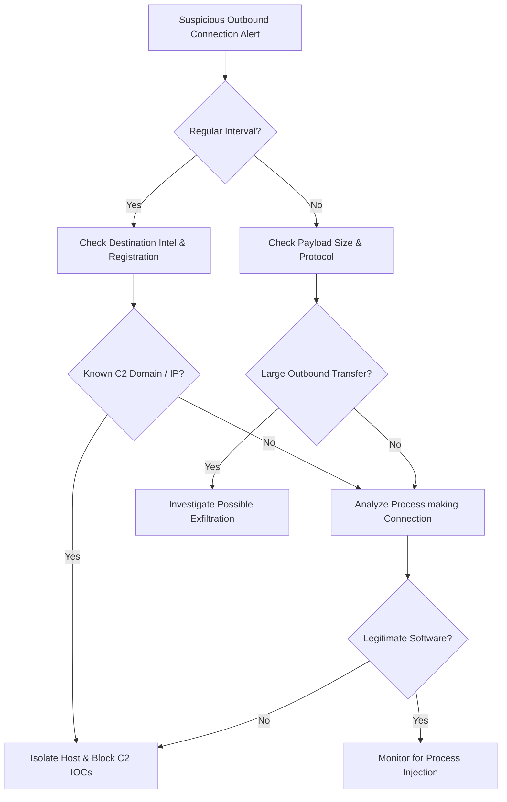

## Problem Scenario

Quickly detect, confirm, and contain command-and-control (C2) beaconing activity.

**When to Use:**
- Network or EDR alerts indicating possible beaconing or suspicious outbound connections.
- Threat intel hits on domains/IPs associated with C2 frameworks.
- Anomalous proxy/DNS patterns from single hosts.

## Quick Commands

```bash
# Identify periodic connections (example with Zeek logs + shell tools)
cat conn.log | awk '{print $3,$9}' | sort | uniq -c | sort -nr | head

# Check recent DNS queries for suspicious host
Get-DnsClientCache | Where-Object {$_.Entry -like "*examplec2*"}

# Simple Netstat snapshot (Windows)
netstat -ano | findstr ESTABLISHED
```

## Decision Flow



## SOC Detection Indicators

- **High-signal patterns**: Small, periodic HTTPS connections to domains without obvious business justification.
- **Hunting ideas**: Cluster outbound traffic by timing and size to find families of similar beacons.

**Splunk Example (Zeek Conn Logs):**
```spl
index=zeek sourcetype=zeek_conn 
| stats count, var(duration) as var_dur, mean(orig_bytes) as avg_bytes by id.orig_h, id.resp_h, id.resp_p 
| where count > 50 AND var_dur < 1 AND avg_bytes < 500
```

**Elastic Example (Sysmon Network):**
```kql
winlog.event_id: "3" AND winlog.event_data.DestinationPort: ("443" OR "80" OR "53") AND NOT winlog.event_data.Image: (*chrome.exe OR *firefox.exe OR *msedge.exe)
```

**Sigma Rule (Conceptual):**
```yaml
title: Suspicious Periodic Network Connection via Uncommon Process
logsource:
    category: network_connection
    product: windows
detection:
    selection:
        DestinationPort:
            - 80
            - 443
    filter_browsers:
        Image|contains:
            - '\chrome.exe'
            - '\firefox.exe'
    condition: selection and not filter_browsers
```

## Next Investigation Steps

- **Work with IR to**:
  - Acquire memory and disk images from affected hosts.
  - Identify initial infection vector (phishing, drive-by, vulnerable service).
- Feed:
  - C2 indicators into block lists, EDR IOCs, and long-term threat intel repositories.
- Document:
  - Timeline of first/last seen, infrastructure used, and data exfiltration signs.

## References

- Zeek (Bro) Docs: `https://docs.zeek.org/`
- MITRE ATT&CK C2 Techniques: `https://attack.mitre.org/tactics/TA0011/`


