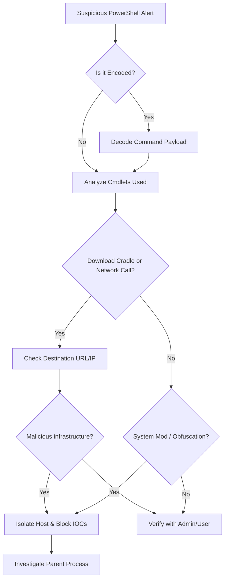

## Problem Scenario

Identify, analyze, and contain malicious or unauthorized PowerShell execution within the environment.

**When to Use:**
- Alerts for encoded PowerShell commands (`-enc`, `-e`, `-EncodedCommand`).
- PowerShell execution bypassing execution policies (`-ExecutionPolicy Bypass`).
- Download cradles (`IEX`, `Net.WebClient`, `Invoke-WebRequest`).

## Quick Commands

```bash
# Decode Base64 PowerShell command on Linux/macOS
echo "JABzAD0ATgBlAHcALQBPAGIAagBlAGMAdAAgAEkATwAuAE0AZQBtAG8AcgB5AFMAdAByAGUAYQBtACgAWwBDAG8AbgB2AGUAcgB0AF0AOgA6AEYAcgBvAG0AQgBhAHMAZQA2ADQAUwB0AHIAaQBuAGcAKAAiAEgA... )" | base64 -d | iconv -f UTF-16LE -t UTF-8
```

```powershell
# Search for recent PowerShell execution in Windows Event Logs
Get-WinEvent -LogName "Windows PowerShell" -MaxEvents 50 | Where-Object {$_.Message -match "IEX"}
```

## Decision Flow



## SOC Detection Indicators

- **High-signal patterns**: `IEX (New-Object Net.WebClient).DownloadString(...)`, obfuscated variable names, execution from unusual directories (`C:\PerfLogs`, `C:\Users\Public`).

**Splunk Example (Sysmon or PowerShell Operational):**
```spl
index=windows (EventCode=4104 OR EventCode=1) 
| search "IEX" OR "Invoke-Expression" OR "DownloadString" OR "Hidden" OR "EncodedCommand"
| stats count by Computer, User, CommandLine
```

**Elastic Example:**
```kql
winlog.event_data.CommandLine: (*-enc* OR *-EncodedCommand* OR *IEX* OR *DownloadString*) AND winlog.event_id: ("1" OR "4104")
```

**Sigma Rule (Conceptual):**
```yaml
title: Suspicious PowerShell Download Cradle
logsource:
    product: windows
    service: powershell
detection:
    selection:
        EventID: 4104
        ScriptBlockText|contains:
            - 'Net.WebClient'
            - 'DownloadString'
            - 'IEX'
            - 'Invoke-RestMethod'
    condition: selection
```

## Next Investigation Steps

- **Analyze Context**: Identify the parent process of `powershell.exe` (e.g., `cmd.exe`, `wmiprvse.exe`, `word.exe`, `excel.exe`).
- **Review Network**: Check firewall logs for connections around the time of execution.
- **Extract Payloads**: If a script was downloaded, attempt to retrieve the payload securely for analysis.
- **Check Persistence**: Review registry run keys and scheduled tasks created by the script.

## References

- MITRE ATT&CK PowerShell: `https://attack.mitre.org/techniques/T1059/001/`
- PowerShell ScriptBlock Logging: `https://learn.microsoft.com/en-us/powershell/module/microsoft.powershell.core/about/about_logging_windows`
