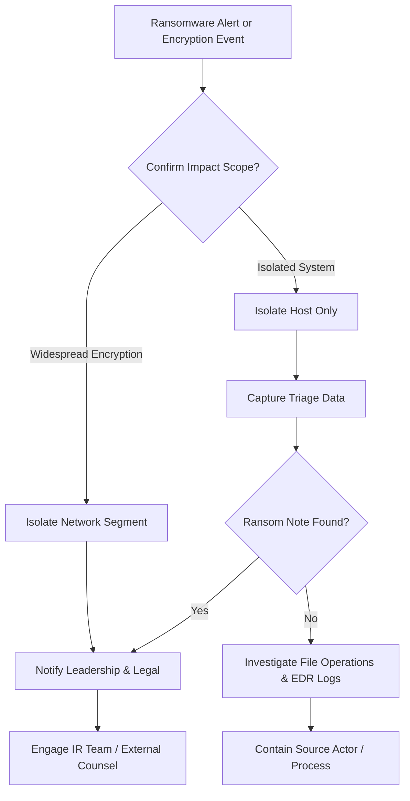

## Problem Scenario

This playbook provides a high-speed checklist for responding to suspected or confirmed ransomware incidents.

**When to Use:**
- Any encryption event on critical systems or file servers.
- Ransom notes detected on endpoints or shared drives.
- EDR/AV detections naming ransomware families or mass file modification.

## Quick Commands

```bash
# Windows: capture triage data (example)
mkdir C:\IR && cd C:\IR
wevtutil epl System system.evtx
wevtutil epl Security security.evtx
wevtutil epl "Microsoft-Windows-Sysmon/Operational" sysmon.evtx

# List recently modified files (Linux)
find / -type f -mtime -1 -printf "%T+ %p\n" 2>/dev/null | sort -r | head -n 50

# Snapshot network connections (Windows PowerShell)
Get-NetTCPConnection | Select-Object -First 30
```

## Decision Flow



## SOC Detection Indicators

- **Pre-ransom indicators**: Increased use of admin tools (PsExec, wmic), mass authentication attempts, group membership changes.
- **Encryption phase indicators**: Spikes in file write operations, file renames, mass creation of ransom note filenames.

**Splunk Example:**
```spl
index=sysmon EventCode=11 TargetFilename="*\\readme.txt" OR TargetFilename="*.crytp" 
| stats count by Computer, User 
| where count > 50
```

**Elastic Example:**
```kql
winlog.event_id: "11" AND winlog.event_data.TargetFilename: (*readme.txt OR *.encrypted)
```

**Sigma Rule (Conceptual):**
```yaml
title: Potential Ransomware Note Creation
logsource:
    category: file_event
    product: windows
detection:
    selection:
        TargetFilename|endswith: 
            - '\readme.txt'
            - '\DECRYPT_FILES.txt'
    condition: selection
```

## Next Investigation Steps

- **Preserve**:
  - Golden images, backups, and key artifacts (logs, memory dumps, note samples).
  - Copies of ransom notes and communication channels for law enforcement and legal.
- Coordinate:
  - With business owners to prioritize system restoration.
  - With communications teams on internal and external messaging.
- After-action:
  - Document root cause, dwell time, and control failures.
  - Update detection, hardening baselines, and this playbook.

## References

- CISA Ransomware Guidance: `https://www.cisa.gov/stopransomware`
- NCSC Ransomware Guidance: `https://www.ncsc.gov.uk/collection/ransomware`


