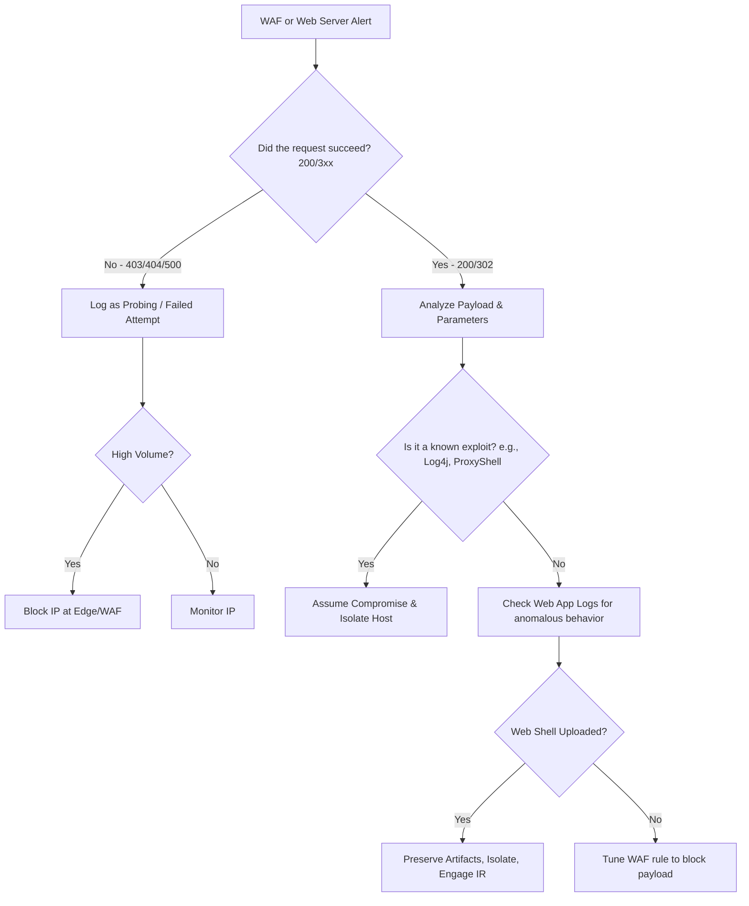

## Problem Scenario

Detect and investigate successful or attempted exploitation against external-facing web applications, such as SQLi, RCE, or Server-Side Request Forgery (SSRF).

**When to Use:**
- WAF alerts indicating high-severity payload matches.
- Web server logs showing anomalous status codes (500s) or execution of unexpected binaries.
- Suspected web shell drops.

## Quick Commands

```bash
# Grep for common web shell extensions or patterns in Linux web root
grep -RoE "(system|eval|exec|shell_exec|base64_decode)\s*\(" /var/www/html/ 

# Check Nginx/Apache logs for Top 10 IP address sources of 404s/500s
awk '($9 ~ /404|500/)' /var/log/nginx/access.log | awk '{print $1}' | sort | uniq -c | sort -nr | head -10

# Search IIS logs for SQL injection keywords
Select-String -Path "C:\inetpub\logs\LogFiles\W3SVC1\*.log" -Pattern "(union|select|xp_cmdshell|--)"
```

## Decision Flow



## SOC Detection Indicators

- **High-signal patterns**: Sudden spikes in WAF blocks from a single IP, successful requests immediately followed by unusual outbound network traffic (reverse shell), or child processes spawning from `www-data` / `w3wp.exe`.

**Splunk Example (Web Access Logs):**
```spl
index=web sourcetype=access_combined 
| regex uri_query="(?i)(union.*select|exec.*xp_cmdshell|<script>|/etc/passwd)" 
| stats count, values(status) by clientip, uri_path
```

**Elastic Example (Auditbeat / Sysmon):**
```kql
process.parent.name: ("w3wp.exe" OR "nginx" OR "httpd" OR "tomcat") AND NOT process.name: ("csc.exe" OR "w3wp.exe")
```

**Sigma Rule (Conceptual):**
```yaml
title: Suspicious Child Process of Web Server
logsource:
    category: process_creation
    product: windows
detection:
    selection:
        ParentImage|endswith:
            - '\w3wp.exe'
            - '\httpd.exe'
            - '\tomcat.exe'
            - '\nginx.exe'
    filter_compilers:
        Image|endswith:
            - '\csc.exe'
            - '\vbc.exe'
    condition: selection and not filter_compilers
```

## Next Investigation Steps

- **Investigate the Host**: Review EDR alerts and process trees on the web server. Check for modifications to scheduled tasks or unexpected new users.
- **Review Database**: If SQLi is suspected, check database audit logs for unauthorized queries or exfiltration.
- **Containment**: Isolate the server if active C2/lateral movement is observed. Place WAF in blocking mode for the identified attack signature.

## References

- OWASP Threat Dragon / Top 10: `https://owasp.org/www-project-top-ten/`
- SANS Web Application Attacks: `https://www.sans.org/`
